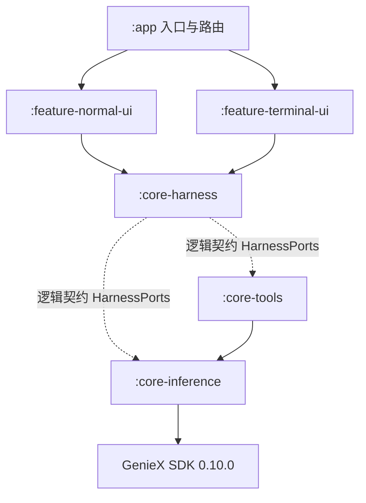
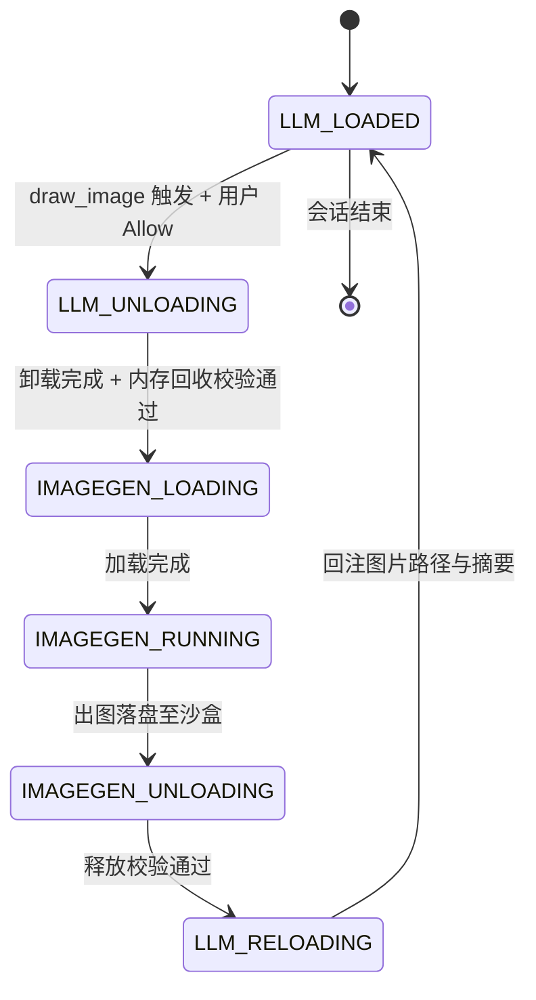

# QAA 架构说明

> 单一事实来源：版本、接口契约与硬约束以本文为准；修改需通过 Issue → PR。

## 1. 技术事实表（钉死，勿漂移）

| 项 | 值 | 备注 |
| --- | --- | --- |
| applicationId | `com.thatgfsj.qaa` | 可在拍板前统一调整，调整需同步本文 |
| 端侧推理 | `com.qualcomm.qti:geniex-android:0.10.0`（Maven Central） | 附带 arm64-v8a 原生库，应用侧无需 NDK/CMake |
| minSdk / ABI | 27 / 仅 `arm64-v8a` | 官方要求 minSdk 27 |
| 语言与 UI | Kotlin 2.x + Jetpack Compose + Coroutines，Java 17 toolchain | |
| 推理路径 | GenieX llama_cpp（GGUF），量化优先 Q4_0 | Hexagon NPU 对 Q4_0 算子支持最完整 |
| 冒烟模型 | Supra2.5-Pro-Instruct **Q4_0 GGUF**（67M，约 40MB） | HuggingFace：liodon-ai/Supra2.5-Pro-Instruct-GGUF |
| 目标硬件 | 骁龙 8 Gen 2 ~ 8 Elite Gen 5 | 模拟器仅验 UI/逻辑 |
| 参考实现 | github.com/qualcomm/ai-hub-apps → `geniex_chat_android` | 官方参考 App |
| 本机 QAIRT SDK | `/home/thatgfsj/Downloads/v2.52.0.261104`（hexagon v66~v85） | GenieX qairt 路径底层 |

## 2. 模块依赖



> 依赖注记：:core-harness 为纯 JVM 库，图中 HAR→INF / HAR→TOOL 为**逻辑契约**关系（虚线）——端口接口定义在 :core-harness（HarnessPorts.kt），由 :app 在装配层注入 Android 侧实现（依赖倒置）；:app 同时承担 harness 与 inference/tools 的运行时装配。

| 模块 | 职责 | 禁止 |
| --- | --- | --- |
| :app | ui_mode 持久化路由、双前端启动、立即重启工具、DI 装配 | 业务逻辑 |
| :core-inference | LlmEngine、BackendFallbackManager、InferenceMetrics、内置模型释放器、断点续传下载器、ModelMemoryCoordinator | 引入 Compose / Android UI |
| :core-harness | Agent Loop、TreeSessionStore(JSONL)、ContextCompactor、SteerQueue、SkillRegistry、AgentConfig | 引入 Android 框架依赖（必须可 JVM 单测） |
| :core-tools | ToolExecutor 统一路由、沙盒文件系统、read/write/edit、ImageGenEngine 抽象、draw_image 占位 | 直接持有 GenieX 对象 |
| :feature-normal-ui | 会话页 / 模型管理页 / 设置页 / 后端状态栏 | 绕过 harness 直连引擎 |
| :feature-terminal-ui | Shell 命令解析器、全中文 help、三段式视图、实时统计栏 | 同上 |

## 3. 核心契约接口（保持同等解耦粒度）

```kotlin
enum class ComputeBackend { AUTO, NPU, HYBRID, CPU }

data class AgentConfig(
    val yoloMode: Boolean = false,          // 手机端默认关闭，预留扩展接口
    val maxToolSteps: Int = 12,
    val compactThresholdRatio: Float = 0.8f,
)

interface ToolExecutor {
    val name: String
    val requiresConfirmation: Boolean
    suspend fun execute(argsJson: String, context: ToolContext): ToolResult
}

interface ImageGenEngine {
    suspend fun load(modelPath: String)
    suspend fun generate(prompt: String, outputPath: String): Result<String>
    suspend fun unload()
}
```

## 4. 后端降级链

初始化顺序固定：**Hexagon NPU → Hybrid（Adreno GPU）→ CPU**。任一层算子不兼容或初始化失败即逐层回退；实际命中后端作为状态流对外暴露，Normal 状态栏与 Terminal 顶部常驻栏均订阅同一数据源。`backend [auto|npu|hybrid|cpu]` 支持手动锁定。

## 5. ModelMemoryCoordinator 互斥状态机（硬约束）

手机 RAM 与 NPU 上下文有限，**严禁 LLM 与画图模型同时驻留内存**：



强制流转：LLM 产出提示词 → draw_image → Allow 确认（非 YOLO）→ 卸载 LLM（校验回收）→ 加载 ImageGenEngine 出图落盘 → 卸载 → 按需重载 LLM → 结果回注 Agent Loop。任何非法状态迁移必须被状态机拒绝并报错。

## 6. 双前端启动路由

- `ui_mode`（NORMAL / TERMINAL）经 DataStore 持久化，MainActivity 启动时读取并路由至独立入口，两视图状态互不共享。
- Normal → Terminal：设置页"切换至极客终端模式" → 写配置 → 立即重启 App。
- Terminal → Normal：终端输入 `start window` → 写配置 → 立即重启 App。

## 7. Agent Loop 概览

单步循环：模型流式输出 → 工具调用 JSON 严格解析（容错提取 + 重试上限）→ 非授权确认（Allow / Deny，yoloMode 预留默认 false）→ ToolExecutor 执行 → 结果回注 → 直至无工具调用或达 maxToolSteps。工具仅 4 个原语：`read` `write` `edit` `draw_image`；System Prompt 保持极简以降低 Prefill 开销。
