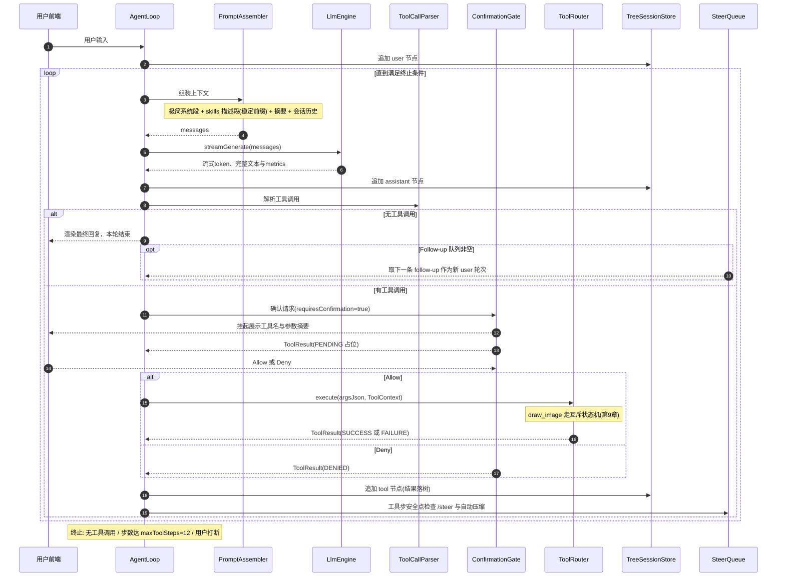
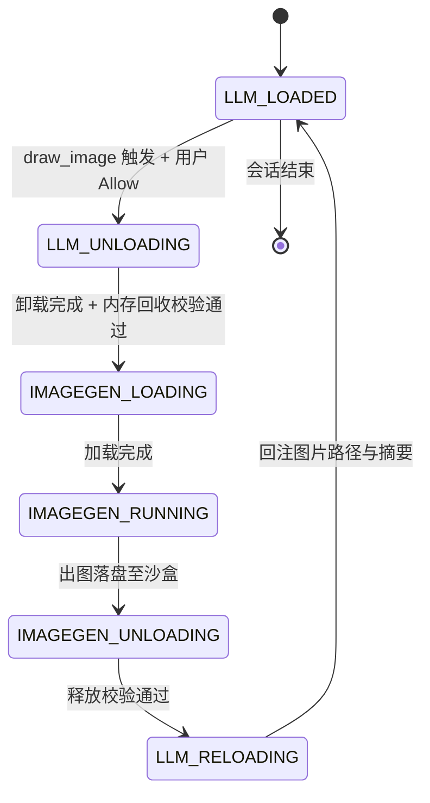

# QAA Pi-Style Harness 核心设计文档

| 项 | 值 |
| --- | --- |
| 文档版本 | v1.0（2026-11-24，作为实现议题 #12–#21 的设计输入） |
| 上游契约 | docs/ARCHITECTURE.md（单一事实来源；对应关系：本文第 1 章↔其第 7 节、第 2/3 章↔其第 3 节、第 9 章↔其第 5 节） |
| 模块归属 | :core-harness / :core-tools / :core-inference 职责切分沿用 ARCHITECTURE.md 第 2 节 |
| 配套附录 | docs/design/harness-core-appendix.md（JVM 单测清单 + 扩展样例） |

> 阅读约定：本文只做设计，不含实现代码；所有 Kotlin 片段均为接口契约或伪代码。标注「与
> ARCHITECTURE.md 一致」的定义，修改必须先经 Issue → PR 同步上游，再改本文。

## 0. 文档定位、设计原则与非目标

### 0.1 定位

本文将 ARCHITECTURE.md 第 7 节的一段式 Agent Loop 概览，细化为可拆解为实现议题
（#12–#21）的模块级设计：Agent Loop、AgentConfig、工具层、解析容错、TreeSessionStore、
Compaction、SteerQueue、SkillRegistry、ModelMemoryCoordinator，并附 JVM 单测清单。

### 0.2 设计原则

| # | 原则 | 落点 |
| --- | --- | --- |
| P1 | 极简优先：能用 1 个工具原语解决就不加第 5 个 | 工具仅 read/write/edit/draw_image 四原语 |
| P2 | 纯 Kotlin、与 Android 解耦、JVM 可单测 | :core-harness 禁 Android 依赖；文件操作经 SandboxFs 接口注入 |
| P3 | 非 YOLO 默认：变更必经用户 Allow/Deny | ConfirmationGate 是循环内的强制环节 |
| P4 | append-only：只追加、不覆写历史 | 会话树 JSONL 与 compaction 摘要均不删除旧节点 |
| P5 | 单一事实来源：契约钉死在上游 | 本文接口引用复制，扩展字段显式标注「本文新增」 |

### 0.3 非目标（负面约束重申，全文档有效）

- 不引入语音交互（ASR/TTS）。
- 不默认开启 yoloMode，且当前版本不提供任何开启入口。
- 不设计 Phase 3 画图引擎具体实现：ImageGenEngine 仅接口占位，选型需用户拍板。
- 不引入重型框架（DI 框架、YAML 库、数据库 ORM 一律不用）。
- 严禁 LLM 与画图模型同时驻留内存（ModelMemoryCoordinator 硬约束，见第 9 章）。

## 1. Agent Loop 设计（:core-harness）

### 1.1 单轮时序图



### 1.2 循环不变量（构造性无死循环）

一次用户轮次内的「生成 → 解析 → 确认 → 执行 → 回注」迭代总数受双重封顶：

- 工具步：每执行一个 ToolCall 计 1 步，Deny 同样计步，硬顶 maxToolSteps = 12；
- 解析重试：连续脏 JSON 最多重试 parseRetryLimit = 2 次，超限即降级禁用工具（见 4.3）。

因此迭代总数 ≤ maxToolSteps + parseRetryLimit + 1 ≈ 15，任何模型行为下轮次必然终止。

### 1.3 终止条件

| 条件 | 判定点 | 行为 |
| --- | --- | --- |
| 无工具调用 | 解析结果为空 | 本轮自然结束；按 7.3 裁决消费 SteerQueue |
| 步数预算耗尽 | step ≥ maxToolSteps=12 | 注入一次性收尾提示，要求基于已有结果直接作答；该次生成禁用工具解析，然后结束 |
| 用户打断 | 工具步边界检查 /steer | 当前单个工具完成后取消剩余工具步，注入转向文本重新生成（见 7.1） |
| 解析降级 | 连续 parseRetry 超限 | 禁用工具解析，文本收尾一次后结束（见 4.3） |

### 1.4 System Prompt 组装规范

组装顺序（自上而下，前缀稳定段在前，动态段在后）：

1. 极简系统段：身份一句话 + 4 工具清单与 JSON 输出模板（4.1）+ 确认机制说明 + 中文作答约定；
2. skills 描述段：SkillRegistry 生成的稳定排序列表（8.3），会话内字节级不变；
3. 摘要段：既有 summary 节点按树序排列（6.4）；
4. 会话历史：保护窗口内节点 + 当前轮次节点（6.3）。

预算目标：第 1+2 段合计 ≤ 600 token（降低 Prefill 开销；实现期实测校准）。系统段与
skills 段合称「稳定前缀」，在一次会话内不得包含任何动态数据，以保护 NPU Prompt Cache 命中。

### 1.5 控制流伪代码（示意，非实现规范）

```kotlin
// 伪代码：仅表达控制流与不变量
suspend fun runTurn(userText: String) {
    store.appendUser(userText)
    var step = 0; var toolsDisabled = false
    while (true) {
        val msgs = assembler.assemble(store, skills)      // 1.4 顺序
        val gen = engine.streamGenerate(msgs)             // 流式
        store.appendAssistant(gen.text, gen.metrics)
        val calls = if (toolsDisabled) emptyList() else parser.parse(gen.text)
        if (calls.isEmpty()) return endTurn()             // 条件A：自然结束
        for (call in calls) {
            val result = gate.confirmAndRoute(call)        // PENDING→Allow/Deny→执行
            store.appendTool(call, result); step++
            if (steer.hasInterrupt()) return steerRedirect()// 条件C：转向
        }
        if (step >= config.maxToolSteps) {                 // 条件B：预算耗尽
            assembler.injectStepBudgetNotice(); toolsDisabled = true
        }
    }
}
```

### 1.6 token 级流式回显（Issue #64）

`runTurn` / `resumeTurn` 接受可选 `onToken: ((String) -> Unit)?`（默认 null 零破坏），
原样传给 `LlmEngineGateway.streamGenerate(messages, onToken)`：每个生成步的引擎片段经
`SteerTurnDriver.drive` 逐层透传到装配层，由 `AssistantTokenRelay` 以生成步粒度转成
Started / Delta / Finished 事件，Terminal 前端据此开启占位 AI 行、增量追加并在步末定稿。
落树仍以整步 `GenerationOutput.text` 为准，未传回调时行为与既有一致。

- 工具调用 JSON 的生成步在步末以空文本收口，UI 丢弃该临时行，保持「调用 JSON 不进对话区」；
- 压缩摘要等内部生成走装配层的独立引擎调用，不经过该回调，token 不外透。

## 2. AgentConfig 契约（:core-harness）

### 2.1 契约定义（与 ARCHITECTURE.md 第 3 节逐字一致）

```kotlin
data class AgentConfig(
    val yoloMode: Boolean = false,          // 手机端默认关闭，预留扩展接口
    val maxToolSteps: Int = 12,
    val compactThresholdRatio: Float = 0.8f,
)
```

### 2.2 字段语义

| 字段 | 默认 | 语义 |
| --- | --- | --- |
| yoloMode | false | false 时所有 requiresConfirmation=true 的工具必经 Allow/Deny；true（预留）时确认门自动放行。当前版本无开启入口；若未来启用，须同步修订 ARCHITECTURE.md 第 5 节 draw_image 的 Allow 守卫描述 |
| maxToolSteps | 12 | 单个用户轮次内工具步硬顶；口径=已执行 ToolCall 数（含 Deny）；达限走收尾路径（1.3） |
| compactThresholdRatio | 0.8f | 上下文 token 占用率触发线：usedTokens / contextBudget ≥ 0.8 即自动压缩（第 6 章） |

### 2.3 冻结与扩展规则

- AgentConfig 字段冻结为上表 3 个；新增配置字段必须先修订 ARCHITECTURE.md 第 3 节。
- ComputeBackend 等推理侧契约归 :core-inference，本文不重定义，仅在 metrics 中引用其实际命中值。

## 3. 工具层设计（:core-tools）

### 3.1 ToolExecutor 契约（与 ARCHITECTURE.md 第 3 节逐字一致）

```kotlin
interface ToolExecutor {
    val name: String
    val requiresConfirmation: Boolean
    suspend fun execute(argsJson: String, context: ToolContext): ToolResult
}
```

### 3.2 ToolContext 与沙盒文件系统（本文新增，不与上游冲突）

```kotlin
interface ToolContext {
    val sessionId: String        // 所属会话（树文件）
    val stepIndex: Int          // 当前工具步序号
    val sandbox: SandboxFs      // 路径门面：所有路径先归一化并校验授权根
    val limits: ToolLimits      // 输出截断预算（read 8000 字符、write 64KB 等）
}

sealed class SandboxRoot {
    abstract val id: String
    data class File(override val id: String, val directory: Path) : SandboxRoot()
    data class Saf(override val id: String, val treeUri: String,
                   val displayName: String, val gateway: SafDocumentGateway) : SandboxRoot()
}

interface SandboxFs {
    suspend fun resolve(path: String): ResolvedPath     // 越界→E_PATH_ESCAPE
    suspend fun exists(path: String): Boolean
    suspend fun readText(path: String, maxChars: Int): String
    suspend fun writeText(path: String, content: String)          // File：临时文件+原子重命名；SAF：覆盖流
    suspend fun applyEdit(path: String, oldText: String,
                          newText: String, replaceAll: Boolean): EditOutcome
}
```

- 授权根为组合根：File 根（App 私有目录）走 NIO 并保留符号链接逃逸校验；SAF 根
  （storage grant，ROADMAP Phase 2）只携带树 Uri + `SafDocumentGateway`，全部文件操作经
  DocumentsContract / ContentResolver 语义逐段解析 DocumentId，**不映射 /storage 真实路径**
  （targetSdk 35 分区存储下不可直访）。Android 网关实现位于 app 层，:core-tools 只依赖接口
  → JVM 单测用临时目录/内存网关。SAF 根的写入为 openOutputStream 覆盖（无原子替换），
  授权边界由树本身限定，无符号链接逃逸面；'..' 仍在词法层拒绝。
- :core-tools 禁止直接持有 GenieX 对象（上游第 2 节）；draw_image 只经 ImageGenEngine 抽象。

### 3.3 四工具参数 schema

通用约定：args 为 JSON 对象；未知字段忽略；字符串一律 UTF-8；路径先经 sandbox.resolve。

**read** —— requiresConfirmation = **false**（只读，非变更类）

| 字段 | 类型 | 必填 | 语义 |
| --- | --- | --- | --- |
| path | string | 是 | 授权根内路径；读取文本内容 |

细则：超 limits.read 截断并在 output 末尾附截断标记与总长度；前 8KB 含 NUL 判定二进制 →
FAILURE(E_BINARY_FILE)；文件不存在 → FAILURE(E_NOT_FOUND)。

**write** —— requiresConfirmation = **true**（整体覆盖语义）

| 字段 | 类型 | 必填 | 语义 |
| --- | --- | --- | --- |
| path | string | 是 | 目标路径；不存在则连同父目录创建 |
| content | string | 是 | 完整写入内容；文件已存在则全量替换 |

细则：先写临时文件再原子重命名，防半写损坏；内容超 limits.write → FAILURE(E_SIZE_LIMIT)。

**edit** —— requiresConfirmation = **true**；精确字符串替换（literal，非正则）

| 字段 | 类型 | 必填 | 语义 |
| --- | --- | --- | --- |
| path | string | 是 | 目标文件，必须已存在（不隐式创建） |
| oldText | string | 是 | 待替换的精确文本片段；空串非法 → E_EMPTY_OLD_TEXT |
| newText | string | 是 | 替换文本；空串 = 删除匹配片段 |
| replaceAll | boolean | 否，默认 false | false 时 oldText 须恰好出现 1 次 |

细则：未匹配 → FAILURE(E_NOT_FOUND) 并附最近似片段提示；多处匹配且 replaceAll=false →
FAILURE(E_MULTI_MATCH) 且 output 报告匹配数。整文件重写请改用 write。

**draw_image** —— requiresConfirmation = **true**；Phase 3 接口占位

| 字段 | 类型 | 必填 | 语义 |
| --- | --- | --- | --- |
| prompt | string | 是 | 画图提示词（由 LLM 生成） |
| outputPath | string | 否 | 落盘路径；缺省在沙盒 images/ 下自动命名 |

Phase 2 行为：引擎未接入时预检失败 → 直接 FAILURE(E_ENGINE_NOT_AVAILABLE)，不触发确认、
不触发内存状态机（见 9.5）。Phase 3 行为：Allow → 互斥链出图落盘（第 9 章）。

### 3.4 统一 ToolResult（本文新增）

```kotlin
enum class ToolResultStatus { SUCCESS, FAILURE, DENIED, PENDING }

data class ToolResult(
    val status: ToolResultStatus,
    val output: String,        // 回注 LLM 的文本，四态皆有（见下表）
    val dataJson: String?,     // 可选结构化附加数据（如图片路径），无则 null
    val errorCode: String?,    // 仅 FAILURE 携带稳定错误码
    val durationMs: Long,
)
```

| 状态 | 含义 | output 语义 | 回注策略 |
| --- | --- | --- | --- |
| SUCCESS | 执行成功 | 内容/路径/结果摘要 | 直接回注，进入下一轮生成 |
| FAILURE | 执行失败 | 人可读原因（含稳定错误码） | 回注；模型可改参重试，受步数预算约束 |
| DENIED | 用户拒绝 | 固定话术：已拒绝 + 建议改用纯文字或调整方案 | 回注 |
| PENDING | 确认挂起占位 | 固定话术：等待用户决策 | 不回注 LLM；仅 UI 与内存态，不落树 |

PENDING 不持久化：树中只落终态 tool 节点；进程崩溃后挂起作废、恢复时重问。

### 3.5 稳定错误码

E_ARGS_INVALID / E_PATH_ESCAPE / E_NOT_FOUND / E_MULTI_MATCH / E_EMPTY_OLD_TEXT /
E_BINARY_FILE / E_SIZE_LIMIT / E_IO / E_ENGINE_NOT_AVAILABLE / E_MEMORY_MUTEX。
错误码是对 LLM 与测试共用的稳定标识，一经发布不复用改名。

### 3.6 确认挂起流（ConfirmationGate）

- 触发条件：requiresConfirmation=true 且 yoloMode=false（默认恒真）。
- 挂起内容：工具名 + 参数摘要（write/edit 展示目标路径与变更前后片段；draw_image 展示 prompt）。
- 决策：Allow → 执行；Deny → DENIED 回注；无自动超时，后台/锁屏不取消挂起。
- 挂起中收到 /steer：视为 Deny 当前挂起 + 注入转向（7.1）。
- UI 无关性：Gate 暴露 suspend 请求接口，Normal 卡片与 Terminal 行内 y/n 各自实现交互。

## 4. 工具调用解析容错（ToolCallParser，:core-harness）

### 4.1 Structured Output 模板（系统段原文设计）

```text
你可直接用中文回答用户。
若需要使用工具，只输出一个 JSON 对象，不要附加其他文字：
  {"tool": "工具名", "args": { ...参数... }}
可用工具：read / write / edit / draw_image（参数规范见工具清单）。
```

规范：每步至多 1 个调用；args 为 JSON 对象；多余字段（如 thought）允许存在但被忽略。
允许模型把 JSON 包在代码围栏中，解析器对围栏与裸 JSON 一视同仁。

### 4.2 脏 JSON 提取管线（五级，任一级成功即停）

| 级 | 动作 | 说明 |
| --- | --- | --- |
| 0 | XML 方言提取（#107） | `<tool_call>` 内 JSON、Qwen 系 `<function=…><parameter=…>`、真机 `arg_key/arg_value` 三种形态，缺闭合标签宽容；围栏内与示例语境（示例/例如/格式/如下/写作 等前后 24 字符窗口）不执行；解析失败返回 Invalid 交纠错 |
| 1 | 围栏剥离 | 提取代码围栏内容（json 标记或裸围栏）；多个围栏取第一个含 "tool" 的 |
| 2 | 首花括号定位 | 从全文第一个 { 起截取，容忍前置闲聊文本 |
| 3 | 括号配平扫描 | 逐字符扫描（正确处理字符串字面量与转义引号），深度归零处截取首个完整对象 |
| 4 | 截断修补 | 流被截断、深度未归零时，按栈补齐缺失的引号/方括号/花括号（最多 3 层），仅此一次 |
| 5 | 字段校验 | tool ∈ 四工具白名单；args 为对象（缺省视作空对象）；参数级校验交各 executor |

数组容忍：提取到顶层数组时按序展开为多个调用（同一步预算内顺序执行）；模板不鼓励但解析器兼容。
别名容忍：canonical 为 tool/args；name/arguments 形态在 canonical 失败后兜底接受。

工具痕迹兜底（#107）：L0 与 L1–L5 均未提取出调用时，若文本仍残留结构化工具痕迹（`<tool_call>` 后接 ASCII 工具名或 JSON 起头、`<function=NAME>` 的 NAME 为 ASCII 标识符），不再当终答，而是返回 Invalid 触发纠错/降级——修复真机上「合法 XML 调用被静默吞掉、确认门永不触发」的缺陷；散文提及（如「参数用 `<arg_key>` 与 `<arg_value>` 包裹」）不误判。HTML 实体（`&lt;tool_call&gt;`）解码见 #108。

### 4.3 重试上限与自然语言降级（严禁死循环）

| 机制 | 值 | 语义 |
| --- | --- | --- |
| parseRetryLimit | 2（内部常量，非 AgentConfig 字段） | 连续解析失败后回注纠错提示（附原截断片段与模板），至多重试 2 次 |
| 降级动作 | 禁用工具 + 文本收尾 | 超限后注入：「工具调用解析多次失败，请不要再尝试调用工具，直接用文字回答用户。」本轮后续生成禁用工具解析 |

与 1.2 的双重封顶共同构成无死循环保证；降级路径也受 maxToolSteps 硬顶约束。

### 4.4 失败路径一览

| 场景 | 行为 | 落树 |
| --- | --- | --- |
| 提取/校验失败 | 纠错提示回注重试（计 parseRetries） | assistant 节点 metrics.parseRetries++ |
| 未知工具名 | 同上，回注白名单 | 同上 |
| 参数类型错 | E_ARGS_INVALID 作为 FAILURE 回注 | tool 节点 FAILURE |

## 5. TreeSessionStore 设计（:core-harness）

### 5.1 存储形态

单会话单文件 sessions/&lt;sessionId&gt;.jsonl，append-only；两种记录：meta（指针游标，后写
覆盖前写）与 node（树节点）。首行建议写一条 meta。文件尾行半写（进程崩溃）时加载器跳过
该行并告警，不阻断会话恢复。

### 5.2 记录 schema（schemaVersion = 1）

node 记录（完整样例见附录 B.1）：

```json
{
  "recordType": "node", "schemaVersion": 1,
  "id": "n-000123", "parentId": "n-000122",
  "role": "assistant",
  "content": "……完整生成文本……",
  "toolCalls": [
    { "callId": "c-000123-0", "tool": "write", "argsJson": "{ … }" }
  ],
  "tags": [],
  "timestamp": 1763932800123,
  "metrics": {
    "backend": "NPU", "ttftMs": 210, "tokensPerSec": 18.4,
    "promptTokens": 1350, "completionTokens": 96,
    "stepIndex": 3, "parseRetries": 0, "durationMs": 4200
  },
  "compaction": null
}
```

meta 记录（activeLeafId 为当前活动分支叶子，读端取最后一条为准）：

```json
{ "recordType": "meta", "schemaVersion": 1,
  "activeLeafId": "n-000126", "updatedAt": 1763932800456 }
```

### 5.3 字段字典

| 字段 | 类型 | 必填 | 语义 |
| --- | --- | --- | --- |
| recordType | string | 是 | "meta" 或 "node" |
| schemaVersion | int | 是 | 当前 1；读端忽略未知字段（前向兼容），破坏性变更才递增 |
| id | string | 是 | 会话内唯一、单调递增，形如 n-XXXXXX |
| parentId | string/null | 是 | 父节点 id，根节点为 null；树结构由此构成 |
| role | string | 是 | system / user / assistant / tool / summary |
| content | string | 是 | user=输入原文；assistant=完整生成；tool=回注 output；summary=压缩摘要 |
| toolCalls | array | 否 | 仅 assistant：[{callId, tool, argsJson}]，本步解析出的调用 |
| callId, tool | string | 条件 | 仅 role=tool：回链 assistant.toolCalls 与工具名 |
| toolStatus | string | 条件 | 仅 role=tool：SUCCESS / FAILURE / DENIED（PENDING 不落树） |
| errorCode | string/null | 否 | 仅 FAILURE 附带 |
| tags | array | 否 | 标记，如 /steer 注入的 user 节点带 "steer" |
| timestamp | long | 是 | epoch 毫秒 |
| metrics | object | 否 | assistant：backend（实际命中，ActiveBackend：NPU/HYBRID/GPU/CPU）/ttftMs/tokensPerSec/promptTokens/completionTokens/stepIndex/parseRetries/durationMs；tool：durationMs/stepIndex |
| compaction | object/null | 否 | 仅 role=summary：被压缩范围引用（见 6.4） |

### 5.4 /tree 与 /fork 语义

- /tree：按 parentId 渲染整棵会话树（id、role、内容首行摘要、toolStatus、分叉点标记，
  当前活动分支高亮）。只读命令，随时可执行。
- /fork [节点ID]：以指定节点为分叉点开新分支；缺参 = 当前 activeLeafId。效果 = 追加一条
  meta，activeLeafId := 分叉点 id；此后新节点的 parentId 链回溯至分叉点——即**新分支 root
  指向分叉点**，分叉点本身仍属原分支历史、不复制。原分支完整保留、可回溯、可再次 fork 回去。
  节点不存在 → 报错提示；Agent 轮次进行中 → 拒绝并提示本轮结束后再执行（防树指针写冲突）。

### 5.5 LoRA 微调轨迹导出

导出单元 = 一条分支线性链（沿 parentId 自 leaf 回溯至根；默认活动分支，可指定叶子）。
产物 = SFT 轨迹 JSONL（messages 风格），一行一条样本：

| 树字段 | 轨迹字段 | 规则 |
| --- | --- | --- |
| role | messages[].role | user/assistant 直映射；tool→"tool"；summary 默认剔除（可配为 system 段） |
| content | messages[].content | 直映射 |
| toolCalls | messages[].tool_calls | [{id=callId, function:{name=tool, arguments=argsJson}}] |
| toolStatus=FAILURE/DENIED | 默认剔除该样本段 | 可配保留并标注 rejected |
| metrics | 旁注 meta（可选开关） | 供数据质量过滤（如 tokensPerSec 下限） |
| PENDING / 解析失败节点 | 一律剔除 | 不产生训练噪声 |
| 系统段 | messages[0] | 极简系统段 + skills 描述段，与运行时组装一致（训练/推理分布对齐） |

样例行见附录 B.2。

## 6. Compaction 设计（ContextCompactor，:core-harness）

### 6.1 Token 计数监控

- 主计数：每次生成结束取 InferenceMetrics.promptTokens（GenieX 实测 prefill）作为当前
  上下文真实占用；completionTokens 仅累计入会话统计。
- 估算兜底：引擎未返回时按字符近似（ASCII ≈ 4 字符/token，CJK ≈ 1 字/token），取
  max(实测, 估算) 防低估。
- 预算：contextBudget = 模型上下文窗口 − 输出预留（建议 1024）− 系统段固定开销；
  usedRatio = usedTokens / contextBudget。

### 6.2 触发机制

| 途径 | 语义 |
| --- | --- |
| 自动 | 在两类安全点检查 usedRatio ≥ compactThresholdRatio(0.8)：(a) 每个工具步边界（tool 节点落树后、下次生成前）；(b) 轮次自然结束点。流式生成中与确认挂起中绝不触发 |
| 手动 /compact | 空闲时立即执行；运行中排队至最近安全点（先于下一条 follow-up） |

### 6.3 保留策略

保护窗口（完整保留、不压缩）：

1. 当前进行中轮次的全部节点（user/assistant/tool）；
2. 最近 1 个已完成轮次的 user 与 assistant 文本节点；
3. 最新一条工具输出节点全文；
4. 既有 summary 节点（历史摘要不重复展开）。

其余更早节点（含旧工具输出）→ 送入摘要化。被摘要输入超长时先按节点截断再生成。

### 6.4 摘要节点回写与被压缩范围引用

- 摘要由当前 LLM + 固定极简模板生成，要求四段式输出：用户目标 / 已完成操作与结果 /
  关键文件路径 / 未决事项。
- summary 节点：role=summary；parentId = 被压缩链段首节点的 parentId（挂回树中原位置，
  保持时序）；compaction 字段引用被压缩范围：

```json
"compaction": {
  "coveredFrom": "n-000001", "coveredTo": "n-000018",
  "nodeCount": 23, "estimatedTokens": 5200,
  "createdAt": 1763932800456
}
```

- 范围语义：从 coveredTo 沿 parentId 回溯至 coveredFrom（含两端）的活动链段。分叉场景
  下节点 id 不保证连续，故用链段端点引用而非数值区间；侧分支不在压缩范围、不受影响。
- 原节点不删除（append-only）；运行时组装时，链上落在被压缩范围内的节点被跳过，由
  summary 的 content 取代（组装顺序见 1.4 第 3 步）。
- 压缩后目标水位：usedRatio ≤ 0.5（留出再增长空间；实现期校准）。

## 7. SteerQueue 设计（:core-harness）

双队列：steer（打断转向，高优先）与 followUp（自然衔接，低优先）。前端负责把运行中的
用户输入标记为 steer（/steer 前缀或等价入口）或 followUp（普通输入）入队。

### 7.1 /steer 语义（等当前单个工具完成 → 打断转向）

- 工具执行是原子段、不可中断；置位中断标志后在**当前工具步边界**生效：取消本轮剩余
  工具步与后续生成，把 steer 文本作为新 user 节点（tags=["steer"]）注入，自当前上下文
  重新生成。
- 确认挂起中收到 /steer：视为 Deny 当前挂起 + 转向注入（用户转向意图优先）。
- 纯文本流式生成中收到 /steer：不硬切流，本轮自然结束后按 7.3 裁决优先注入。

### 7.2 Follow-up 队列

- 运行中的普通输入入队、不打断；轮次自然结束（含预算耗尽与降级收尾）后 FIFO 逐条衔接，
  每条作为完整新 user 轮次走 Agent Loop。
- 队列不持久化（进程内语义）：App 被杀后队列丢弃，会话树已持久化、用户可重发。此为
  明确取舍，见第 12 章开放问题。

### 7.3 并存优先级裁决

注入点统一为「轮次结束 / 转向边界」，裁决序：

1. steer 队列非空 → 先消费 steer（FIFO；多条 steer 逐条独立成轮，每条走完整循环）；
2. steer 空 → 消费 followUp 一条；
3. 两队列皆空 → 空闲等待用户输入。

不变量：steer 恒先于 followUp；同队列内严格 FIFO。

## 8. SkillRegistry 设计（:core-harness）

### 8.1 目录与扫描

- 布局：&lt;appPrivate&gt;/skills/&lt;skill-name&gt;/SKILL.md，一技能一目录；目录名即 skill id
  （小写 kebab-case）。首启可复用内置模型释放器机制从 assets 释放种子技能。
- 时机：App 启动扫描一次 + /skills refresh 手动重扫。单个技能校验失败仅告警跳过，不崩溃。

### 8.2 SKILL.md frontmatter 约定

```markdown
---
name: skill-name
description: 一句话描述（建议 ≤ 80 汉字，是命中判定的唯一文本依据）
---

（正文 = 完整技能指令，仅在命中后按需加载）
```

- name 必填、全局唯一（重名后者告警跳过）；description 必填、单行。
- 解析为极简行解析（--- 分隔 + key: value），不引入 YAML 库（负面约束）。

### 8.3 启动仅注入描述段（稳定前缀保护 Prompt Cache）

System Prompt 的 skills 段格式固定、按 name 字典序排序（字节级稳定）：

```text
## 可用技能（任务与某技能描述匹配时，先用 read 工具读取其 SKILL.md 全文，再按全文执行）
- code-review: 审查 Kotlin 代码并给出修改建议
- daily-report: 生成每日工作简报
```

该段属 1.4 的稳定前缀：会话内不变（排序固定、格式固定、无动态数据），NPU Prefill 缓存
可命中；会话历史作为后缀追加，不破坏前缀。

### 8.4 命中判定与按需读全文的注入时机

- 判定主体 = LLM 自身：系统段引导语即判定规则；harness 不做关键词匹配（极简取舍）。
- 注入时机：模型命中某技能后主动调用 read 读取 skills/&lt;name&gt;/SKILL.md；全文经
  ToolResult 回注，自下一轮生成起成为上下文一部分、按全文执行。
- 体积约束：SKILL.md 建议 ≤ 4KB，超长由 read 截断策略兜底。
- /skills：列出 name + description（与注入段同源数据，Terminal 命令）。

## 9. ModelMemoryCoordinator 状态机（:core-inference，硬约束）

### 9.1 状态枚举与迁移图（与 ARCHITECTURE.md 第 5 节 mermaid 一致）

状态枚举（仅此 6 个）：LLM_LOADED / LLM_UNLOADING / IMAGEGEN_LOADING /
IMAGEGEN_RUNNING / IMAGEGEN_UNLOADING / LLM_RELOADING。



生命周期说明：状态机自「App 启动、LLM 加载完成」起接管（LLM 冷启动加载期归 LlmEngine
自管理，不属互斥状态机管辖），避免为图外过程增设状态、保持与上游一致；会话结束即终止
迁移（全部释放）。

### 9.2 迁移表与校验点

迁移 = 事件 + guard 校验 + 动作 + 原子提交；任一环节失败则不提交（停留原态），见 9.4。

| # | from | 事件 | 校验点（guard） | to |
| --- | --- | --- | --- | --- |
| 1 | LLM_LOADED | draw_image 获用户 Allow | 确认记录在案；当前上下文已全部持久化到会话树（重载后可重建） | LLM_UNLOADING |
| 2 | LLM_UNLOADING | 卸载完成 | **内存回收校验**：LLM 引用已释放（引擎句柄置空）；MemoryProbe 实测可用内存回升达到安全水位 | IMAGEGEN_LOADING |
| 3 | IMAGEGEN_LOADING | load 完成 | **互斥校验**：断言 LLM 不在内存（引用计数 0）；ImageGenEngine 加载成功 | IMAGEGEN_RUNNING |
| 4 | IMAGEGEN_RUNNING | 出图完成 | 输出文件存在、非空、路径在沙盒授权根内 | IMAGEGEN_UNLOADING |
| 5 | IMAGEGEN_UNLOADING | 释放完成 | 释放校验：画图引擎引用释放、MemoryProbe 实测内存回收 | LLM_RELOADING |
| 6 | LLM_RELOADING | 重载完成 | 互斥校验：画图引擎不在内存；上下文自会话树重建完成；图片路径与摘要已回注 | LLM_LOADED |
| 7 | LLM_LOADED | 会话结束 | 无（终止迁移，全部释放） | [*] |

### 9.3 非法迁移拒绝语义

- 迁移表显式实现（6 状态 × 允许边集合，与上图 7 条边一一对应，无新增无删除）。
- 请求迁移时 from ≠ 当前状态，或 (from → to) 不在表内 → 抛 IllegalTransitionException
  （携带当前态与请求态），**状态保持不变**，调用方收到 FAILURE(E_MEMORY_MUTEX) 与人可读
  话术；拒绝事件全部落日志（供统计栏与验收回溯）。
- 幂等：请求目标 == 当前状态 → 直接成功返回（防重入风暴）。
- 并发模型：单 actor 串行，迁移原子提交；外部并发请求按最新态校验后接受或拒绝。

### 9.4 失败处理与图外恢复

guard 校验或动作失败 = 该次迁移不提交、停留原状态、有限次退避重试（建议 3 次）。重试
耗尽 → 状态机实例销毁、由 App 层重建（回到初始 [*] → 重新加载 → LLM_LOADED），当前
draw_image 返回 FAILURE(E_MEMORY_MUTEX) 并提示用户。该恢复路径是图外生命周期操作，
不新增图内迁移边，从而与上游第 5 节保持严格一致。

### 9.5 与 draw_image 的接线（Phase 3 接口占位）

- Phase 2（引擎未接）：executor 预检 ImageGenEngine 可用性 → 直接
  FAILURE(E_ENGINE_NOT_AVAILABLE)：不触发确认、不迁移状态机（避免无意义打断）。
- Phase 3：Allow → MMC.requestImageGenCycle(prompt, outputPath) 同步驱动全链（对
  executor 是一次 suspend 调用）→ 成功回 SUCCESS(output=图片路径+尺寸摘要)。互斥周期内
  AgentLoop 阻塞在工具步上，天然无并发；若未来引入并行工具，须在 Loop 层禁止 draw_image
  与其他工具并行。
- ImageGenEngine 契约（与 ARCHITECTURE.md 第 3 节逐字一致）；引擎选型需用户拍板
  （ROADMAP Phase 3 人工门禁），本文不设计具体实现：

```kotlin
interface ImageGenEngine {
    suspend fun load(modelPath: String)
    suspend fun generate(prompt: String, outputPath: String): Result<String>
    suspend fun unload()
}
```

## 10. 需求覆盖对照

| 任务书条目 | 章节 |
| --- | --- |
| 1 Agent Loop 时序（mermaid sequenceDiagram） | 1.1–1.5 |
| 2 AgentConfig 契约（yoloMode/maxToolSteps/compactThresholdRatio） | 2.1–2.3 |
| 3 ToolExecutor + 4 工具 schema + requiresConfirmation + edit 精确替换 + ToolResult 四态 | 3.1–3.6 |
| 4 解析容错（模板/脏 JSON 提取/重试上限/降级话术） | 4.1–4.4 |
| 5 TreeSessionStore JSONL schema + /tree //fork + LoRA 映射 | 5.1–5.5 |
| 6 Compaction（0.8 阈值/手动/保留策略/摘要回写与范围引用） | 6.1–6.4 |
| 7 SteerQueue（/steer/Follow-up/优先级裁决） | 7.1–7.3 |
| 8 SkillRegistry（扫描/frontmatter/稳定前缀/按需全文） | 8.1–8.4 |
| 9 ModelMemoryCoordinator（枚举/迁移表/校验点/拒绝语义） | 9.1–9.5 |
| 10 JVM 单测清单 | 附录 A |

## 11. 与 ARCHITECTURE.md 的一致性自查

| 自查项 | 上游出处 | 结论 |
| --- | --- | --- |
| AgentConfig 三字段与默认值（false/12/0.8f） | 第 3 节 | 一致（2.1 逐字引用） |
| ToolExecutor 签名 name/requiresConfirmation/execute(argsJson, context) | 第 3 节 | 一致（3.1 逐字引用） |
| ImageGenEngine 签名 load/generate/unload | 第 3 节 | 一致（9.5 逐字引用） |
| ComputeBackend 归属 :core-inference | 第 3 节 | 一致（本文不重定义，仅引用实际命中值） |
| MMC 状态集与 7 条迁移边 | 第 5 节 mermaid | 一致（9.1 原图引用；9.2 迁移表逐边对应） |
| 「任何非法状态迁移必须被状态机拒绝并报错」 | 第 5 节 | 一致（9.3 拒绝语义，状态不变） |
| Agent Loop 概览流程与 4 工具原语、极简 System Prompt | 第 7 节 | 一致（第 1 章 + 1.4） |
| 负面约束（无语音/不默认 yolo/不越界 Phase 3） | ROADMAP | 一致（0.3 重申） |

结论：本文所有接口契约与 ARCHITECTURE.md 第 3 节逐字一致，状态机与第 5 节 mermaid
边集一一对应，无越界设计。本文新增定义（ToolContext/SandboxFs/ToolResult/节点 schema 等）
均显式标注，不与上游冲突；若需升级为全局契约，须先同步修订上游。

## 12. 开放问题（移交实现议题）

1. MemoryProbe 安全水位的具体值（NPU/Java heap 双口径）→ Phase 2 真机实测校准。
2. follow-up 队列是否需要跨进程持久化（当前取舍：不持久化）。
3. 系统段 + skills 描述段的 token 预算实测校准（当前目标 ≤ 600）。
4. draw_image 缺省 outputPath 的自动命名规则细节。
5. LoRA 导出的 rejected 样本保留开关默认值（当前建议默认剔除）。

## 13. 附录索引

- 附录 A（JVM 单测清单，按模块列出关键用例，供实现议题直接引用）与附录 B（扩展样例：
  会话节点 JSONL 片段、LoRA 导出样例行、确认挂起展示字段清单）见
  docs/design/harness-core-appendix.md。
