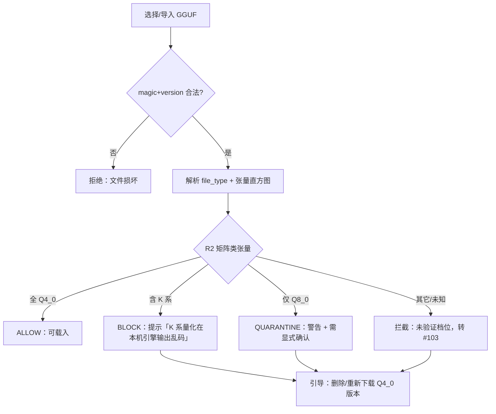

# GenieX 0.10 模型量化兼容性取证包（#97 固化 / #102 数据源）

| 项 | 值 |
| --- | --- |
| 状态 | 草稿（分支 `docs/quant-evidence`，待 Lead 审定后入库/发 issue） |
| 取证日期 | 2026-11-25（复述当日 01:00–03:35 真机实测，本包**无新增真机操作**） |
| 设备 | 小米 25102RKBEC（myron）· SM8850 骁龙 8 Elite Gen 5 · Android 17（SDK 37，HyperOS）· 15.4 GB RAM · arm64-v8a · adb 49322194 |
| 引擎 | GenieX 0.10.0（AAR；GGUF 路径 `llama_cpp`，HTP 路径 `libnpu_jni.so`） |
| 被测应用 | QAA v0.1.3（`main ef461e9`），release 非 debuggable（证书 SHA-256 前缀 `f20fa3df…05e2`） |
| 关联 | #97（乱码）· #102（兼容门禁）· #103（自建引擎分流）· #111（模型删除） |

## 0. 结论（TL;DR）

**判定轴 = GGUF 量化类型。arch / pre-tokenizer / 词表规模已用成对单变量对照排除。**

| 量化 | `general.file_type` | 权重块 | 真机结论 | 数据点 |
| --- | ---: | --- | --- | --- |
| Q4_0 | 2 | Q4_0 | ✅ **可用** | 3 个文件（含 2 组成对对照） |
| Q4_K_M | 15 | Q4_K / Q6_K / Q5_K | ❌ **必乱码** | 4 个独立文件、4 种 arch |
| Q8_0 | 7 | Q8_0 | ⚠ 真机 1 例乱码，单变量未闭环 | 1 个文件（架构混淆） |

一句话：**GenieX 0.10.0 的 GGUF 反量化路径只有 Q4_0 块在真机被验证正确；K 系量化块在 SM8850 + Android 17 上稳定输出符号汤。** 应用侧无法修复（引擎内部），只能选型规避（#102 门禁）+ 分流自建引擎（#103）。

## 1. 复现矩阵

### 1.1 环境（复现前置）

- 构建：release、`debuggable=false`（A 类 Modified-UTF-8 abort 只在 debuggable 包触发，见 `evidence/crash-taxonomy.md`）。
- 后端：优先 CPU（唯一无崩溃路径，C 类）；NPU 仅在短上下文可用，长上下文会撞 B 类 HTP abort。
- `nCtx = 4096`、`maxTokens = 512`（与 `#100` 的上下文预算结论一致）。
- 模型经 LOCALFS 导入（`filesDir/geniex/models/local/...`），无 `geniex.json` 清单，按文件名推断布局。

### 1.2 模型 × 量化 × 后端实测矩阵

| # | 模型文件 | 量化 | arch / pre | 后端 | 输出 | 依据 |
| ---: | --- | --- | --- | --- | --- | --- |
| 1 | Supra2.5-Pro-Instruct-Q4_0（内置 43.6 MB） | Q4_0 | qwen3 / default | NPU（auto） | ✅ 正常，TTFT 25 ms / 409.6 tok/s | [报告] 性能表 |
| 2 | Supra2.5-Pro-Instruct-Q4_K_M（53.9 MB，残缺下载） | Q4_K_M | qwen3 / default | CPU | ❌ 符号汤 | [Issue#97] C3 |
| 3 | Spark-X2.6-4B-Q4_K_M（3.31 GB） | Q4_K_M | spark2_5 / spark2_5 | CPU | ❌ 符号汤，111–134 tok/s | [报告] 性能表 |
| 4 | Spark-X2.6-4B-Q4_K_M（同一文件） | Q4_K_M | spark2_5 / spark2_5 | NPU | 💥 B 类 abort（长上下文） | [报告] 崩溃三类 |
| 5 | Spark-X2.6-4B-Q4_0（2.24 GB，同模型重量化） | Q4_0 | spark2_5 / spark2_5 | CPU | ✅ 流畅中文，13.6 tok/s | [Issue#97] C4 |
| 6 | Huihui-Qwen3.5-4B-abliterated（2.52 GB） | Q4_K_M | qwen35 / qwen35 | CPU | ❌ 符号汤，45.5 tok/s | [报告] + [证据] 会话导出 |
| 7 | Spark-X2.6-1.7B-Q8_0（1.70 GB） | Q8_0 | spark2_5 / spark2_5 | NPU | ❌ 符号汤，69 ms / 162.6 tok/s | [报告] 性能表（架构混淆） |
| 8 | MiniCPM5-2B-Q4_K_M（1.45 GB） | Q4_K_M | llama / minicpm5 | CPU | ❌ 符号汤，105–108 tok/s | [Issue#97] C2 |
| 9 | MiniCPM5-2B-Math-Q8_0（2.50 GB） | Q8_0 | llama / minicpm5 | — | ⬜ 未上机 | [主机] 头解析 |
| 10 | Qwen3.5-4B-QUASAR-Q4_0（2.52 GB） | Q4_0 | qwen35 / qwen35 | — | ⬜ 真机记录待补 | [主机] 头解析 |

### 1.3 成对单变量对照（决定性证据）

**对照 ①（67M 极小模型，变量隔离最干净）**

| 字段 | A：Q4_0（内置资产） | B：Q4_K_M（主机下载件） | 是否相同 |
| --- | --- | --- | --- |
| arch | `qwen3` | `qwen3` | ✅ |
| pre-tokenizer | `default` | `default` | ✅ |
| vocab | 16,384 | 16,384 | ✅ |
| tokenizer model | gpt2 | gpt2 | ✅ |
| 张量数 | 134 | 134 | ✅ |
| 权重块 | Q4_0×84, Q8_0×1, F32×49 | Q5_0×72, Q8_0×13, F32×49 | ❌ 唯一差异 |
| 真机输出 | 正常 | 符号汤 | — |

**对照 ②（4B 中文模型，同一批权重两个量化档）**

| 字段 | A：Q4_0 | B：Q4_K_M | 是否相同 |
| --- | --- | --- | --- |
| arch / pre / vocab | spark2_5 / spark2_5 / 131,072 | 同左 | ✅ |
| 权重块 | Q4_0×216, Q6_K×1, F32×73 | Q4_K×108, Q6_K×36, Q8_0×37, BF16×37, F32×73 | ❌ 唯一差异 |
| 真机输出 | ✅「我是QAA手机端AI助手，专注于为用户提供便捷、准确的信息服务与问题解答…」 | ❌ 符号汤 | — |

**旁证 ③（跨架构普适）**：`qwen35`（Huihui-4B）与 `llama`（MiniCPM5-2B）的 Q4_K_M 同样乱码 → 非单一架构转换缺陷。

**反证 ④（arch / pre-tokenizer 轴否定）**：`spark2_5` 这个「非 default、不在官方 pre 表内」的 pre-tokenizer 在 Q4_0 档下完全正常 →「pre 表缺失导致乱码」被证伪。C2 的 `minicpm5` 缺席证据（`libllama.so` 仅含 `minicpm`/`minicpm3`，见上游草稿 observation 1）只能证明「引擎存在静默回退」，不能单独解释乱码——同族 `llama` 架构缺 Q4_0 对照，故该条只作旁证，不作主因。

### 1.4 复现率

| 档位 | 观测回合数 | 乱码率 | 备注 |
| --- | ---: | ---: | --- |
| Q4_0 | ≥6（含 4B 长回合、中文、工具回合） | 0% | 仅「不守指令」问题，非乱码 |
| Q4_K_M | ≥10（4 个文件） | 100% | 无一次正常 |
| Q8_0 | 1（Spark-1.7B） | 100%（n=1） | 与 arch 混淆，待补 |

## 2. 乱码的形态特征（#97 一手样本）

原文见 `evidence/garbled-samples.md`（应用内 `/export` 导出的会话轨迹，未改写）。摘录：

```text
#ics!ask:2 access2.2.2P@@@@# pipelineamb:%.2P.5.2P?2:—Pip?PPq+2 us.puP:2L!C!! moment:+!? glucose5αPy Back–2A2PineP Quick:P …
```

```text
onymous=L
 brief

Question�
 brief�!#%
```

形态归纳：

| 特征 | 观测 |
| --- | --- |
| 进程/流式 | 存活，正常结束，无异常、无 abort |
| 字符集 | ASCII 标点 + 拉丁碎片 + U+FFFD（`�`）；**零 CJK 汉字** |
| 可辨残片 | `://` `Other` `Question` `pipeline` `proceed` `policy` 等，无完整句 |
| 长度 | 42–814 字符/回合 |
| 指令遵循 | 0（「只回两个字：好的」「Say OK only」均不满足） |
| 工具调用 | 0（工具回合不产生任何 JSON/XML 调用） |
| tok/s | 45–162（**虚高**，见 §7） |

## 3. 崩溃与乱码的边界（防止误归因）

详见 `evidence/crash-taxonomy.md`。要点：

| 类 | 触发条件 | 与量化关系 | 用途 |
| --- | --- | --- | --- |
| A · Modified-UTF-8 abort | debuggable 构建 + 任意真实模型非 ASCII 输出 | 无关 | 测试程序性问题：真机一律用 release 包 |
| B · HTP KV 调度 abort | release + NPU + 长上下文（67M Q4_0 冒烟在 3647/4096 同样触发） | 无关 | 平台缺陷，NPU 长上下文规避 |
| C · CPU 长回合 | release + CPU | 无关 | **本包全部乱码观测都在此路径**，崩溃干扰已排除 |

纪律：不得写「Q4_K_M 导致崩溃」；只能说「Q4_K_M 在 CPU 上乱码」。

## 4. 根因定位：K 系反量化内核

### 4.1 结构证据

三个 Q4_0 文件的 `token_embd.weight` 分别是 **Q6_K**（Spark-4B）、**Q8_0**（Supra 67M、QUASAR 4B），仍然正常；而纯 Q4_K_M 文件的所有 matmul 权重都是 K 系块 → 乱码。

→ 断裂**不在**「文件里出现 K 系块」，而在 **K 系块的矩阵乘（`ggml_mul_mat`）反量化路径**；embedding 的 gather 路径不受影响。这也解释了为什么不能用「含 K 块就拦」的粗暴规则做门禁（会误伤 Q4_0 档）。

### 4.2 与官方文档的偏差

GenieX 官方模型支持文档（转引 `docs/research/geniex-api.md` §3.3）称：Q4_0 → Hexagon NPU「Best NPU support in llama.cpp. Recommended for most models.」；K-quants → GPU/CPU「Not optimized for Hexagon NPU」。

官方口径是「**K 系在 NPU 未优化**」（性能/落点问题），真机表现是「**K 系在 CPU 上输出错误**」（正确性问题）——**性质更严重，超出文档承诺**，这是向上游提 issue 的核心依据。

### 4.3 定性

- 应用侧不可修复（无源码改引擎）。
- 可规避：Q4_0 选型 + `#102` 门禁拦截。
- 根因需上游确认：K-quant 反量化是否接入了正确的 Snapdragon 后端 kernel（`ggml_backend_sched` 分派 + CPU Q4_K 反量化）。

## 5. #102 门禁的可实现判定规则

### 5.1 数据源

GGUF v3 头即可判定，**不需要加载模型**：`general.file_type`（u32）+ 逐张量 `ggml_type` 直方图 + 张量名（角色）。参考实现 `evidence/gguf_probe.py`（62 行，纯标准库）。

⚠ **不能只看 `general.file_type`**：本项目内 `Supra2.5-Pro-Instruct-Q4_K_M.gguf` 的 `file_type=15` 但权重块实际是 Q5_0/Q8_0/F32（名字与声明都不准）。门禁必须以**张量级直方图**为准。

### 5.2 判定规则

```text
G1 容器校验: magic == 'GGUF' && version in {2,3}          否则 REJECT(文件损坏)
G2 读声明:   file_type = kv['general.file_type'] (u32)
G3 张量分类: 逐 tensor 按 name 判定角色
   R0 非矩阵类 (norm|bias|rope|ssm_a|ssm_d)         → 忽略（F32/F16 正常）
   R1 嵌入类 (token_embd|output|output_norm)        → 允许 F32/F16/BF16/Q8_0/Q6_K
   R2 矩阵类 (attn_*|ffn_*|ssm_*|其余 blk.N.*)      → 必须 Q4_0
G4 判定:
   ALLOW          : R2 全为 Q4_0 且 file_type == 2
   BLOCK_KQUANT   : R2 出现 Q4_K/Q5_K/Q6_K/Q5_0/Q5_1/Q3_K/Q2_K  → 硬拦截（已证乱码）
   QUARANTINE_Q8  : R2 出现 Q8_0 且无 K 系             → 默认拦截 + 可覆盖（真机 1 例乱码，未闭环）
   UNKNOWN        : 其它组合 / 未登记类型             → 默认拦截，标注「未验证档位」
```

### 5.3 决策流



### 5.4 时机与文案

- 时机：① 导入预览（不落盘即可判定）② 载入前二次校验（防外部替换）。
- 文案必须给出**可执行动作**：「该文件为 Q4_K_M 量化，本机引擎会输出乱码；请改用 Q4_0 版本，或删除（见 #111）」。
- 展示字段：量化档位、arch、pre-tokenizer、vocab、判定原因（引用本包 §0 表）。
- arch / pre-tokenizer / vocab **只作提示，不作筛选**（已被 §1.3 反证 ④ 否定）。

## 6. 用户口径：保留 / 删除 / 待补（与 #111 联动）

| 处置 | 模型 | 量化 | 理由 | 依据强度 |
| --- | --- | --- | --- | --- |
| ✅ 保留 | Supra2.5-Pro-Instruct（内置资产，43.6 MB） | Q4_0 | 冒烟/基线，正常 | 实测 |
| ✅ 保留 | Spark-X2.6-4B-Q4_0 | Q4_0 | 4B 中文可用，13.6 tok/s，CPU 稳定 | 实测（成对对照） |
| ✅ 保留 | Qwen3.5-4B-QUASAR-Q4_0 | Q4_0 | 头解析合规，与 Huihui-4B 同架构同词表 | 头解析（实测待补） |
| ❌ 删除 | Spark-X2.6-4B-Q4_K_M | Q4_K_M | 符号汤；NPU 长上下文另触发 abort | 实测 |
| ❌ 删除 | Huihui-Qwen3.5-4B-abliterated | Q4_K_M | 符号汤 | 实测 + 会话导出 |
| ❌ 删除 | MiniCPM5-2B-Q4_K_M | Q4_K_M | 符号汤 | 实测 |
| ❌ 删除 | Supra2.5-Pro-Instruct-Q4_K_M | Q4_K_M | 符号汤，且文件本身残缺（53.9 MB） | 实测 |
| ❌ 删除 | Spark-X2.6-1.7B-Q8_0 | Q8_0 | 实测符号汤；虽架构混淆，但已实测不可用即不可用 | 实测 |
| ⬜ 待补 | MiniCPM5-2B-Math-Q8_0 | Q8_0 | 未上机；同族 Q8_0 预期同缺陷 | 预测（未实测） |
| ⬜ 待补 | Spark-X2.5-4B-Q4_K_M | Q4_K_M | 未上机；K 系预期乱码 | 预测（未实测） |

原则：**实测乱码 → 删（用户的删除依据是「跑不通」，不是「理论上不支持」）**；未实测 → 不删、不导、标注待补；Q4_0 → 保留（含未实测者，但需补真机回执）。

删除能力依赖 `#111` 的 `ModelManagerWrapper.remove(name)`（见 `docs/research/geniex-api.md` §8.3），本包不实现。

## 7. 性能口径修正

| 数字 | 是否可用 | 说明 |
| --- | --- | --- |
| 111–134 / 162.6 / 45.5 tok/s（乱码回合） | ❌ 不可用 | 输出是垃圾 token，速率虚高，不能进性能结论 |
| 409.6 tok/s（67M Q4_0，NPU） | ✅ 可用 | 小模型，仅作冒烟 |
| **13.6 tok/s（Spark-4B Q4_0，CPU）** | ✅ **唯一有效 4B 数字** | 与 LPDDR5X 带宽上限（≈14 tok/s）吻合 |

验收/基准报告若引用 #97 期间的 tok/s，必须加注「乱码回合，数据无效」。

## 8. 待补取证清单（需 Lead 真机，本子代理无设备权限）

| # | 缺口 | 为什么重要 | 建议动作 |
| ---: | --- | --- | --- |
| 1 | `dumpsys dropbox --print data_app_native_crash` 原文 | A/B 两类崩溃目前只有报告摘要，无 tombstone 文本 | release 包复现 B 类后导出；取列表尾部为最新 |
| 2 | `/logs` 全量导出（当前 `device-qa/evidence-applog.txt` 仅 10 行，缓冲上限 500） | 会话内载入/后端切换时序不完整 | 应用内 `/logs` 导出，取最近 500 行 |
| 3 | Q8_0 单变量闭环 | 现仅 1 例且架构混淆 | `llama-quantize --allow-requantize <Supra Q4_0> /tmp/Supra-Q8_0.gguf Q8_0`（43 MB→约 70 MB，最小代价），同设备对比；Q4_0 反量化已验证正确，故此测试只验 Q8_0 反量化路径 |
| 4 | QUASAR-Q4_0 真机回执 | 保留清单里有它但无实测记录 | 载入 → 中文回合 → `/export` + 截图 |
| 5 | 设备模型清单完整导出 | #111 提到 13 条，本包核验 10 个文件 | 应用内模型页导出或 `ModelManagerWrapper.listDetailed()` |
| 6 | 乱码时的 logcat（`GenieX` tag、`[JNI] [extract] compute_unit`、`resolve_device`） | 确认实际后端/是否命中回退 | `adb logcat -s GenieXSdk` 抓取一次乱码回合 |

## 9. 证据索引

| 文件 | 内容 | 校验 |
| --- | --- | --- |
| `evidence/garbled-samples.md` | 会话导出原文（6 段乱码 + 正常对照 + meta） | 源文件 4,826 B，逐字符复制 |
| `evidence/gguf-headers.md` | 10 个 GGUF 头解析汇总表 + 原始 JSON | 脚本可复跑 |
| `evidence/model-sha256.txt` | 7 个文件 sha256 + 字节 + mtime | `sha256sum -b` |
| `evidence/crash-taxonomy.md` | A/B/C 类触发条件与边界 | 引用报告章节 |
| `evidence/upstream-issue-draft.md` | 英文 issue 草稿（**未发布**） | 待 Lead 审定 |
| `evidence/gguf_probe.py` | GGUF v3 头解析参考实现（#102 可复用） | 62 行，纯标准库 |

外部一手来源（不入库）：`docs/benchmarks/phase2-report.md`、#97 issue 正文/评论、`device-qa/`（251 文件）、`qaa-verify/out/20261125-042044/`。

## 附录 A：GGUF 头解析方法

```text
GGUF v3 布局: magic(4='GGUF') | version(u32) | n_tensors(u64) | n_kv(u64)
  | kv[n_kv]: key(str) type(u32) value(按 type: u8/i8/u16/i16/u32/i32/f32/bool/str/arr/u64/i64/f64)
  | tensor_info[n_tensors]: name(str) n_dims(u32) dims[u32...] ggml_type(u32) offset(u64)
判定字段: general.architecture(str) · general.name(str) · general.file_type(u32)
          tokenizer.ggml.model(str) · tokenizer.ggml.pre(str) · tokenizer.ggml.tokens(arr[str],长度=vocab)
ggml_type 关键值: 0=F32 1=F16 2=Q4_0 3=Q4_1 7=Q8_0 8=Q5_0 9=Q5_1 12=Q4_K 13=Q5_K 14=Q6_K 30=BF16
```

## 附录 B：时间线（2026-11-25，Asia/Shanghai）

| 时间 | 事件 | 证据 |
| --- | --- | --- |
| 01:49:35 | 载入内置 Supra-Q4_0（auto→NPU），10 s 后卸载并切 CPU | `device-qa/evidence-applog.txt` |
| 01:49:52 | 载入 Spark-X2.6-4B（CPU） | 同上 |
| 01:56:45 | 载入 Huihui-Qwen3.5-4B（CPU） | 同上 |
| 02:03:20 | `/export` 会话轨迹 → 乱码样本入库 | 同上末行 + `evidence/garbled-samples.md` |
| 02:39–03:35 | DSH 会话内四轮交叉验证（t50–t56）：arch 假设 → MiniCPM5 反证 → 量化轴确立 → 4B 对照闭环 | #97 评论 C1–C4 |
| 03:10 / 03:11 | 主机生成 Spark-4B-Q4_0 与 QUASAR-Q4_0（重量化产物） | `evidence/model-sha256.txt` mtime |

## 附录 C：与 #97 评论链的对应（哪些被确立、哪些被推翻）

| 结论 | 状态 | 本包位置 |
| --- | --- | --- |
| arch 表缺失 → 乱码 | ❌ 已推翻（qwen35 在表内仍乱码；MiniCPM5-2B 用最保守 arch 仍乱码） | §1.3 反证 ④ |
| pre-tokenizer 表缺失 → 乱码 | ❌ 已推翻（spark2_5 在 Q4_0 档正常；minicpm5 缺席无法解释同 arch 的 Q4_0 正常） | §1.3、§4.1 |
| 大词表 → 乱码 | ❌ 已推翻（16,384 词表的 Supra Q4_K_M 同样乱码） | §1.3 对照 ① |
| 量化轴（Q4_0 only） | ✅ 已确立（两组成对对照） | §1.3、§4 |
| Q8_0 同属缺陷类 | ⚠ 结论待定（1 例，架构混淆） | §8 #3 |
| HTP abort 挑模型 | ❌ 已推翻（67M Q4_0 冒烟在长上下文同样 abort） | `evidence/crash-taxonomy.md` |